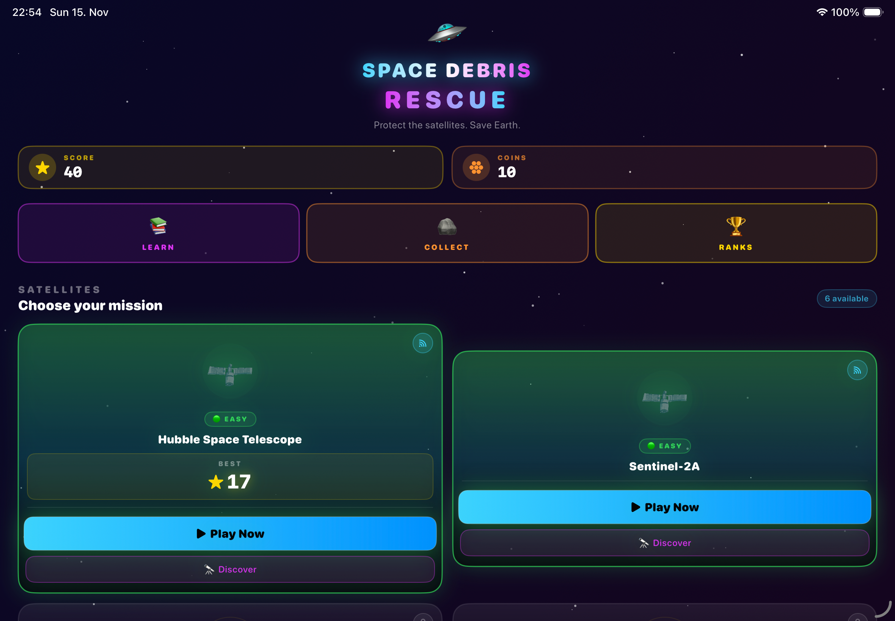
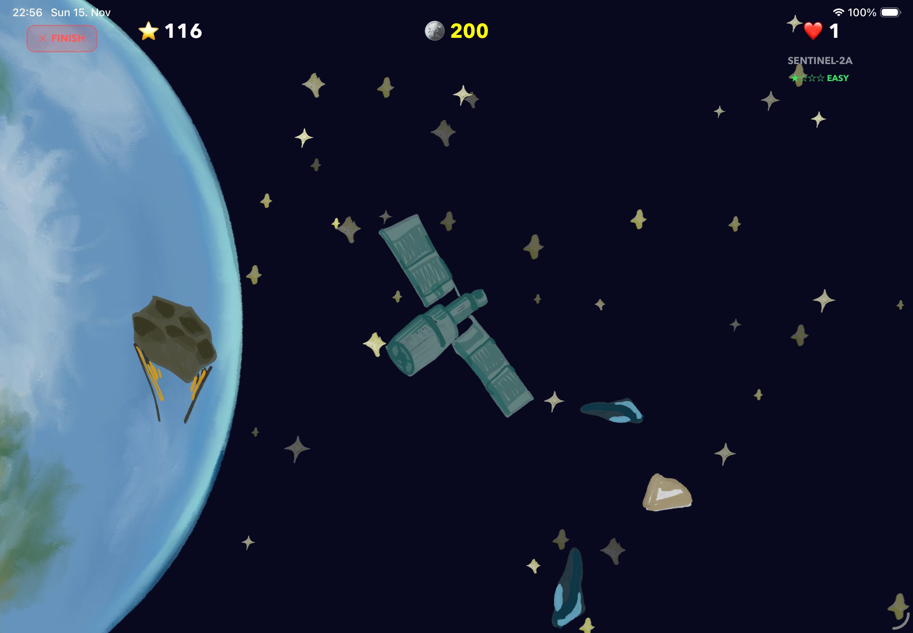
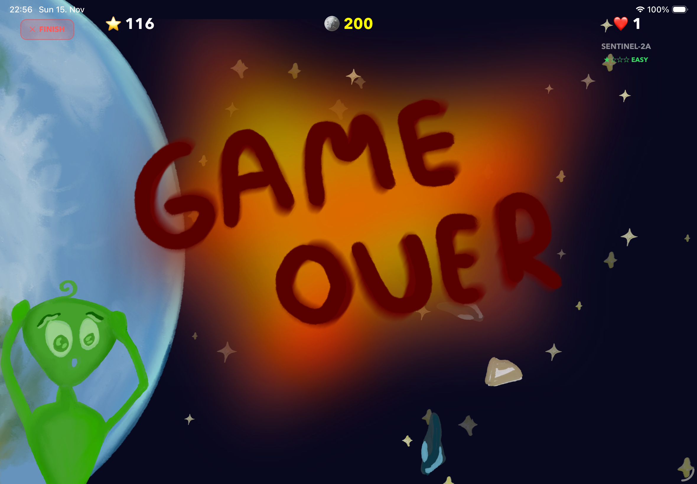
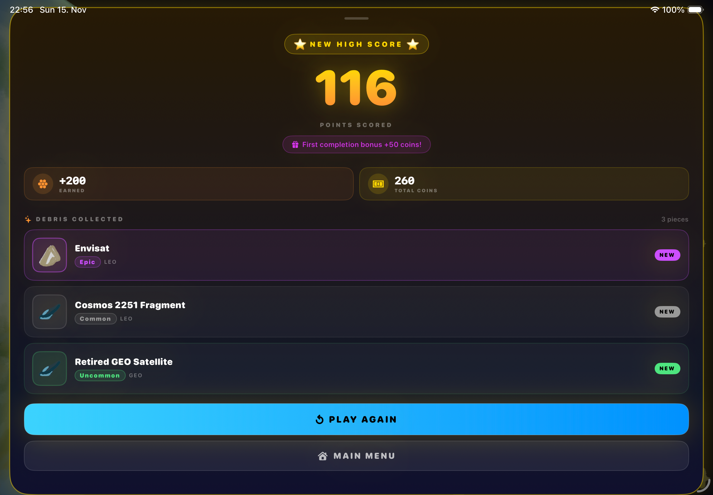
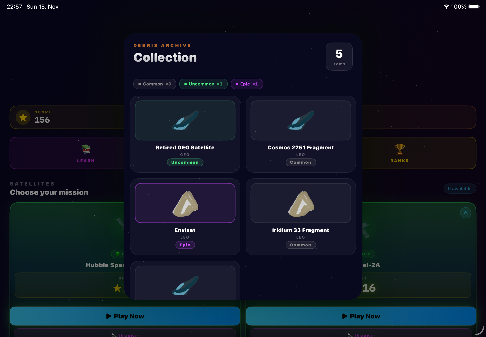
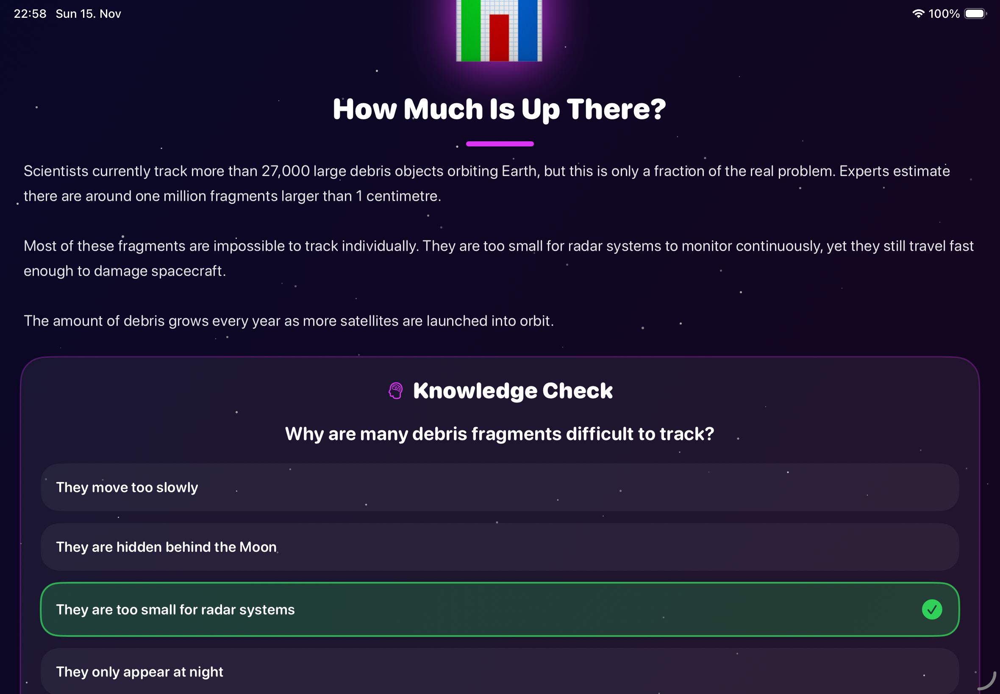
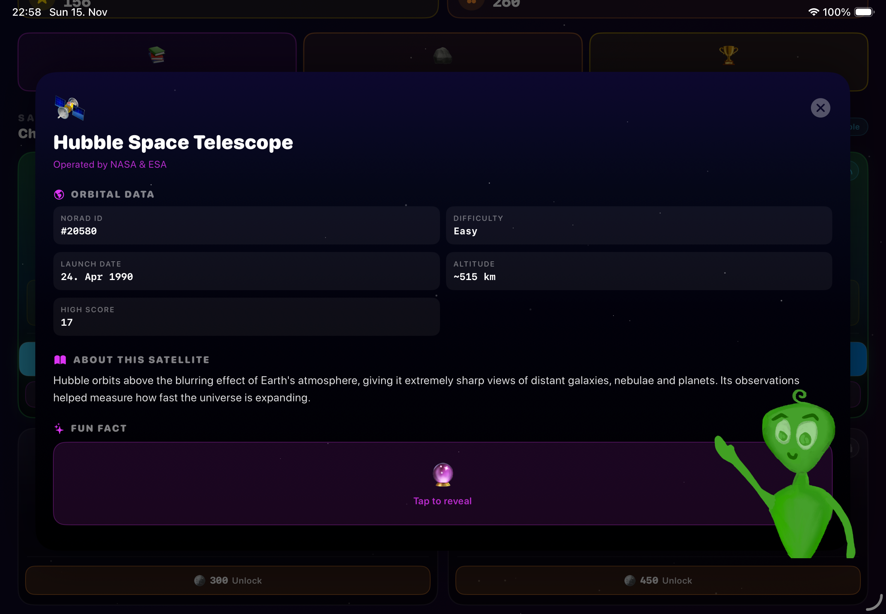

# 🛰️ Space Debris Rescue

An educational iOS game about the growing problem of space debris. Drag junk into Earth's atmosphere to burn it up, tap comets before they hit, and keep working satellites alive, while learning real facts about orbital debris along the way.

Built with **SwiftUI** and **SpriteKit**. It started as the mobile companion to the
[Space Situational Awareness Platform](link).

<p align="center">
  
  
  
  
</p>
<p align="center">
  
  
  
</p>

## 🎬 Demo

https://github.com/user-attachments/assets/a77b112b-04e0-42a6-9b50-635aa17feb34

---

## About the project

Space Debris Rescue was built as an addition to the **Space Situational Awareness (SSA) Platform**, a web-based modular monolith that helps operators monitor satellites and detect possible conjunction (collision) events.

The platform covers the serious, operator side of the topic. This app covers the public side: it turns the same subject into a short arcade game, so players get a feel for why debris is dangerous and why orbit needs protecting.

> **Note:** Both projects are **software engineering experiments**, not real space operations tools. The SSA Platform was built to practise modular monolith architecture, and its orbital and conjunction logic is simplified, so it should not be used for real satellite operations. In this game, the satellite and debris facts are based on real public information, but the gameplay (difficulty, rewards, rarity) is invented for fun.

### Two versions

| Branch | What it is |
|---|---|
| **`main`** | **Offline version.** It runs entirely on the device, with no account or server needed. This is the easiest way to try the app. |
| **`with-backend`** | The original version, connected to the SSA Platform backend. |

In the **`with-backend`** version, the app talked to the platform's **`Modules.Game`** module, which provided:
- user registration and login (JWT, via `Modules.Identity`)
- the satellite list, unlocks and per-satellite details
- game session submission, coin balance and high scores
- debris rewards and the player's collection
- a global leaderboard

The offline version keeps the same features but moves that logic into a local persistence layer.

---

## Features

- 🎮 **Arcade gameplay in SpriteKit:** drag debris into the atmosphere, tap comets away, and survive as the game speeds up.
- 🛰️ **6 real satellites** (Hubble, Sentinel-2A, Landsat 9, ISS, GPS III, GOES-16), each with its own difficulty tier, unlock cost and info sheet with real orbital data.
- 🪨 **Collectible debris** based on real objects such as Vanguard 1, Envisat and fragments of the 2009 Iridium–Cosmos collision, across 5 rarity tiers.
- 🏆 **Personal best runs** and high scores for each satellite.
- 📚 **Learn section:** 12 illustrated topics about space debris, each with a quiz question.
- 💾 **Progress is saved** on the device between launches.
---

## Architecture

The code is organized by feature, with the game engine and the non-UI core kept separate:

```
SpaceSafe/
├── App/              App entry point and root navigation (AppState)
├── Core/
│   ├── Models/       Plain data types (LearnFact, QuizQuestion, …)
│   ├── Data/         Static content: satellites, debris, learn topics
│   └── Persistence/  LocalStore (player progress), DebrisImageStore
├── Game/             SpriteKit scene + the SwiftUI screens around a game session
├── Features/
│   ├── Onboarding/   Launch and intro screens
│   ├── Menu/         Main menu, satellite cards, unlock and info sheets
│   ├── Collection/   Collected debris archive
│   ├── Leaderboard/  Best runs
│   └── Learn/        Educational topics and quizzes
├── DesignSystem/     Shared UI components
└── Resources/        Assets and storyboards
```
---

## Getting started

1. Clone the repo:
   ```bash
   git clone https://github.com/<your-username>/<this-repo>.git
   ```
2. Open the `.xcodeproj` in Xcode 16 or later.
3. Choose an iPhone or iPad simulator and press **Run** (⌘R).

The `main` branch needs no setup. To run the `with-backend` version, switch to that branch and follow the setup instructions in the
[SSA Platform repository](link).

---

## How to play

1. Pick an unlocked satellite on the main menu and tap **Play Now**.
2. **Drag debris** to the left edge of the screen, into Earth's atmosphere, to burn it up and earn coins.
3. **Tap comets** to destroy them. A comet that reaches the satellite costs a life. A comet that hits Earth ends the game.
4. Clear more debris to win collectible debris cards, and spend coins to unlock harder satellites.

---
